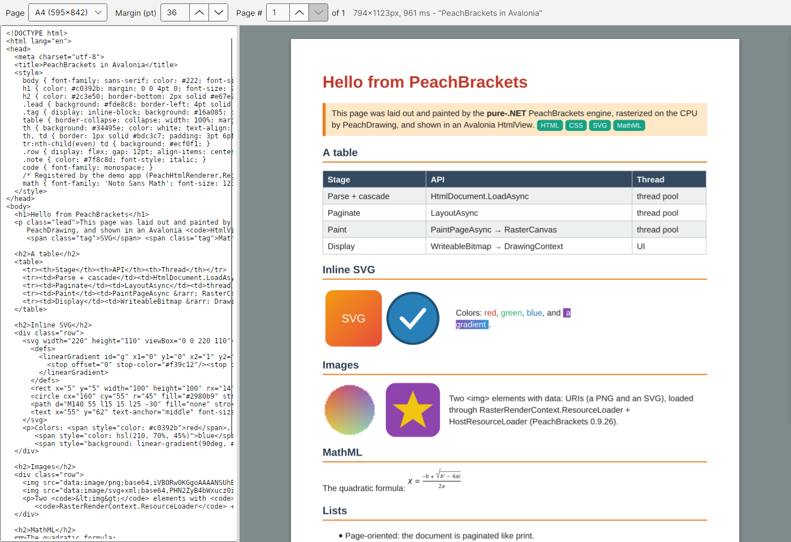

# Avalonia.PeachBrackets

Avalonia 12 controls that render HTML/CSS/SVG/MathML with [PeachBrackets](https://www.nuget.org/packages/PeachBrackets),
the pure-.NET engine behind [PeachPDF](https://github.com/jhaygood86/PeachPDF).

**Status: milestone 1 (proof of concept).** A read-only `HtmlView` lays a document out into pages and shows one page as a
bitmap. Interaction (selection, links, scrolling through pages) comes later.



## Layout

```
Avalonia.PeachBrackets.slnx
Directory.Build.props          shared settings (nullable, implicit usings)
Directory.Packages.props       central, exact package pins
global.json                    .NET SDK 10.0.403 (rollForward: latestFeature)
src/Avalonia.PeachBrackets/    the control library (net8.0; net10.0, trimmable/AOT-flagged)
samples/Avalonia.PeachBrackets.Demo/   demo app (net10.0)
tests/Avalonia.PeachBrackets.Tests/    xunit.v3 + Avalonia.Headless.XUnit
docs/                          progress log, screenshots
```

## Pinned versions

| Package | Version |
| --- | --- |
| PeachBrackets, PeachDrawing, PeachDrawing.Core | `[0.9.25]` (exact; pre-1.0, versioned in lockstep, bump together) |
| Avalonia, Avalonia.Desktop, Avalonia.Themes.Fluent, Avalonia.Fonts.Inter, Avalonia.Skia, Avalonia.Headless, Avalonia.Headless.XUnit | `[12.1.5]` |
| Microsoft.NET.Test.Sdk / xunit.v3 / xunit.runner.visualstudio | `[18.11.0]` / `[3.2.2]` / `[3.1.5]` |

PeachBrackets 0.9.25 pulls in PeachDrawing.Text 0.9.25, PeachImage 0.6.2, MimeKit 4.18.2 and
System.Security.Cryptography.Pkcs 10.0.14 transitively.

## Build, test, run

Needs the .NET 10 SDK (the library also targets net8.0).

```bash
dotnet build
dotnet test
dotnet run --project samples/Avalonia.PeachBrackets.Demo            # desktop window
dotnet run --project samples/Avalonia.PeachBrackets.Demo -- --screenshot docs   # headless: writes docs/demo-screenshot.png + docs/demo-page.png
```

The `--screenshot` mode uses Avalonia.Headless with Skia, so it needs no display. In the window, change the page size,
margin or page number in the toolbar, or edit the HTML on the left; the page re-renders.

## Usage

```xml
<Window xmlns:pb="clr-namespace:Avalonia.PeachBrackets;assembly=Avalonia.PeachBrackets">
  <ScrollViewer>
    <pb:HtmlView Source="avares://MyApp/Assets/page.html"
                 PageWidth="612" PageHeight="792" PageMargin="36" />
  </ScrollViewer>
</Window>
```

```csharp
view.Html = "<h1 style='color:teal'>Hello</h1><p>From PeachBrackets.</p>";
view.RenderCompleted += (_, e) => Console.WriteLine(e.Error?.Message ?? $"{e.Page!.PageCount} page(s)");

// Fonts that are not installed (and every font on WASM) must be registered before rendering:
await PeachHtmlRenderer.Shared.RegisterFontAsync(File.OpenRead("NotoSansMath-Regular.ttf"), "Noto Sans Math");

// Without a control: render a page to pixels or a PNG.
var page = await PeachHtmlRenderer.Shared.RenderPageAsync(html, HtmlPageSettings.A4, pageIndex: 0, pixelsPerPoint: 2);
await PeachHtmlRenderer.Shared.RenderPageToPngAsync(html, HtmlPageSettings.Letter, File.Create("page1.png"));
```

## Public surface (0.1.0-alpha)

All lengths are **points** (1/72 inch), as in PeachBrackets. On screen 1 pt = 96/72 DIP.

### `HtmlView : Control`

| Member | Kind | Notes |
| --- | --- | --- |
| `Html` | `StyledProperty<string?>` | HTML source. Wins over `Source` when non-null. |
| `Source` | `StyledProperty<Uri?>` | `file:`, `http(s):` or `avares:`; read as text, used when `Html` is null. |
| `PageWidth`, `PageHeight` | `StyledProperty<double>` | Sheet size, default A4 595 x 842. A `@page { size }` rule overrides them. |
| `PageMargin` | `StyledProperty<Thickness>` | Default 20 on each side. `@page { margin }` overrides it. |
| `PageIndex` | `StyledProperty<int>` | Page to show, clamped to the last page. |
| `RenderScale` | `StyledProperty<double>` | 0 (default) = the window's `RenderScaling`, so HiDPI stays sharp; otherwise pixels per DIP. |
| `PageBackground` | `StyledProperty<IBrush?>` | Painted behind the page (default white); PeachBrackets leaves unpainted pixels transparent. |
| `UserStyleSheet` | `StyledProperty<string?>` | CSS applied before the document's own styles. |
| `PageCount`, `IsRendering`, `RenderError`, `DocumentTitle` | read-only `DirectProperty` | State of the last render. |
| `CurrentBitmap` | `Bitmap?` | The page bitmap being shown. |
| `Renderer` | `PeachHtmlRenderer` | Defaults to `PeachHtmlRenderer.Shared`. |
| `RenderCompleted` | event | UI thread, after each render that was not superseded; carries `Page` or `Error`. |
| `InvalidateDocument()` | method | Force a re-render. |
| `ToWriteableBitmap(RenderedHtmlPage)` | static | Premultiplied RGBA8 -> `WriteableBitmap` (Rgba8888, Premul). |

Behaviour: property changes made in one dispatcher turn coalesce into one render. A new render cancels the one in flight
and the older result is dropped. Load and layout run on the thread pool. The control's desired size is the page size.

### `PeachHtmlRenderer`

UI-independent pipeline wrapper. It holds one `RasterRenderContext` (font, brush and pen caches; installed fonts are
registered when it is created) and serializes renders, because PeachBrackets documents are not thread safe and the
context is shared.

- `static Shared`, `Context`, `RegisterFontAsync(Stream, family)`
- `RenderPageAsync(html, HtmlPageSettings, pageIndex, pixelsPerPoint, userStyleSheet, ct)` -> `RenderedHtmlPage`
- `RenderPageToPngAsync(html, HtmlPageSettings, Stream, ...)`

### `HtmlPageSettings`, `RenderedHtmlPage`, `HtmlRenderCompletedEventArgs`

`HtmlPageSettings(WidthPoints, HeightPoints, MarginLeft, MarginTop, MarginRight, MarginBottom)` provides `A4`, `Letter`
and `WithUniformMargin`. `RenderedHtmlPage` holds `PageIndex`, `PageCount`, `WidthPoints`, `HeightPoints`,
`PixelsPerPoint`, `PixelWidth`, `PixelHeight`, `PremultipliedRgba`, `Title` and `Elapsed`.

## How it works

```
HtmlDocument.LoadAsync(html, RasterRenderContext, HtmlDocumentOptions{page size, margins, Media="screen"})
  -> LayoutAsync(ctx.CreateCanvas(1, 1))            // measuring only
  -> PaintPageAsync(i, new RasterCanvas(ctx, new RasterSurface(wPx, hPx, 0, 0, ppp, ppp), 1.0))
  -> RasterCanvas.ToPixelBuffer()                   // premultiplied RGBA8, copied out
  -> WriteableBitmap(Rgba8888, Premul, dpi = 72 * ppp) -> DrawingContext.DrawImage
```

## API notes and mismatches found (PeachBrackets / PeachDrawing 0.9.25)

The pipeline names matched: `HtmlDocument.LoadAsync`, `LayoutAsync`, `PaintPageAsync`, `Pages` (`DocumentPage` with
`Index`, `WidthPoints`, `HeightPoints`), `RasterRenderContext`, `RasterCanvas`, `ToPixelBuffer`. These differed from what
was expected:

1. **HiDPI scaling.** The docs say "set `RenderContext.LayoutUnitsPerPoint` before loading", but `RasterRenderContext` is
   `sealed` and the property is get-only (always 1). `RasterRenderContext.CreateCanvas(w, h, dpi)` is fixed at 1 unit = 1 px
   (`dpi` is ignored). **Workaround:** keep layout in points and paint onto
   `new RasterCanvas(ctx, new RasterSurface(wPx, hPx, 0, 0, scale, scale), 1.0)`. Verified at 2x and 1.33x.
2. **No resource loading.** `RasterRenderContext` doesn't override `RenderContext.GetResourceStream`, so the base
   implementation returns null for every URI. `` (including `data:` URIs, which also go through the network loader),
   `<link rel=stylesheet>`, CSS `url()` and `@font-face src:url()` load nothing. `BaseUri` is get-only, so relative URLs can't
   be resolved either. Inline `<svg>`, inline `<style>` and CSS gradients work. **Fix options:** ask upstream to unseal
   `RasterRenderContext` or give it a resource-loader hook or base URI, or write our own `RenderContext` subclass (the font and
   image `*Int` members are `protected abstract`, so this means reimplementing font handling; not a quick job).
3. **Transparent page.** Unpainted pixels are alpha 0. `HtmlView.PageBackground` (white) is painted underneath.
4. **No cancellation inside the engine.** `LoadAsync`, `LayoutAsync` and `PaintPageAsync` take no `CancellationToken`.
   Stale renders are cancelled between stages and their results thrown away.
5. **Media defaults to `print`.** The view sets `HtmlDocumentOptions.Media = "screen"` (RasterRenderContext's
   `GetCssMediaType` also answers `screen`).
6. **Inline MathML baseline.** The inline `<math>` in the sample sits above the text baseline. This is engine behaviour,
   not something the control does.

## Known limitations

- **Page-oriented engine.** PeachBrackets paginates like print. The view shows one page at a time at a fixed sheet size;
  there's no continuous "web page" flow and the layout doesn't reflow to the control's width.
- **Pre-1.0 API.** PeachBrackets/PeachDrawing 0.9.x may change between releases, so the pins are exact. Expect
  adjustments on every bump.
- **Software rasterizer.** Pages are painted on the CPU and uploaded as a bitmap. Every change re-runs load, layout and
  paint for the whole document (the first render took about 1.1 s for the sample, including font-set initialisation).
  Zooming past `RenderScale` blurs.
- **Fonts.** `RasterRenderContext` registers the machine's installed fonts (about 160 ms at startup on the dev box). WASM,
  minimal containers and fonts shipped as assets need `RegisterFontAsync`. MathML needs a math font (the demo bundles
  Noto Sans Math, OFL). Without one, math identifiers render as tofu boxes.
- **No external resources** (see API note 2).
- **No interaction yet.** No selection, links, hover, forms or scrolling between pages.
- **One shared context.** Renders on a renderer are serialized. Create separate `PeachHtmlRenderer` instances for parallel
  rendering; each one costs a font-set scan.

## Next steps

1. **Multi-page and virtualization.** A `HtmlDocumentView` that keeps the laid-out `HtmlDocument` alive, stacks pages
   in a virtualizing panel, and paints only the visible pages, caching or evicting bitmaps by viewport.
   Reuse layout across repaints instead of reloading.
2. **Continuous layout.** Set the sheet width to the control width and the height to "tall", re-layout on resize, and
   suppress page breaks, so the view behaves like a browser viewport.
3. **Selection and hit-testing.** Turn on `RecordTextRuns` and `EnableSelectionStyling`. Map pointer events through
   `HitTest`, `GetCaretPosition` and `Selection.SelectAt` / `ExtendTo` / `SelectWordAt`, repaint `DirtyRegions` with
   `PaintPageRegionAsync`, and copy with `GetText`. Add find (`FindText`, `SetHighlight`).
4. **Links.** Use `Annotations.Links` for hover cursors and a `LinkClicked` event or command; navigate in-document anchors
   via `Destination`.
5. **Resource loading.** Work with upstream on a pluggable resource loader or base URI for the raster context, so
   images and external CSS load. Map `avares:`, `file:` and `http:` through it.
6. **Custom Canvas -> DrawingContext.** Implement `PeachDrawing.Core.Canvas` over Avalonia's `DrawingContext` (or a
   Skia-backed one) for GPU, resolution-independent painting. This needs a full mapping of brushes, paths, clips, blend
   modes, glyph runs and layers. Keep the raster path as the fallback.
7. **Forms and incremental updates.** `CollectFormFields` with overlaid Avalonia input controls; `SetStyle` and
   `ReplaceTextAsync` for live edits without a full reload.
8. **Packaging.** Pick a licence, add a NuGet package, test trimming/AOT (`PublishAot`) and an Avalonia.Browser (WASM)
   sample with bundled fonts.

See [docs/PROGRESS.md](docs/PROGRESS.md) for the per-step log.
